# 📊 UIII Act4: Importación y Descripción de Datos
## Pedro Martinez NC.0093
> **🎓 Asignatura:** Soluciona problemas de Machine Learning  
> **📚 Nivel:** Tercer semestre de preparatoria  
> **🤖 Especialidad:** Inteligencia Artificial  
> **📈 Dificultad:** Cero a principiante  
> **🐍 Lenguaje:** Python  
> **🛠️ Herramientas:** Visual Studio Code, Pandas, Matplotlib y CSV  

---
## CLASES GIMNASIO

## 1.--- TABLA ORIGINAL DE CLASES DE GIMNASIO ---
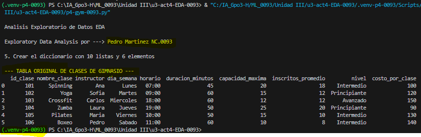
## 2.Convertir el DataFrame en archivo CSV
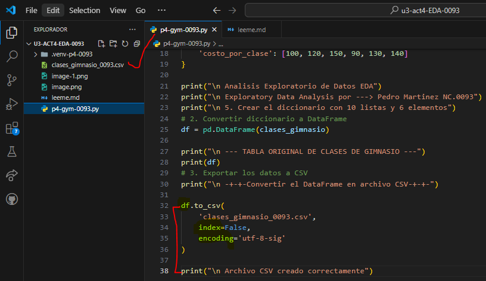
## 3.Datos del CSV ---> Base de datos
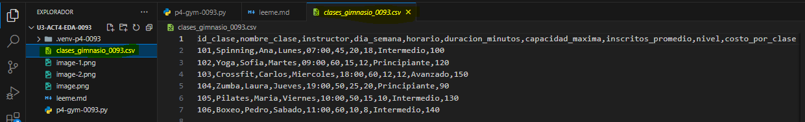
## 4.Leer datos de el CSV
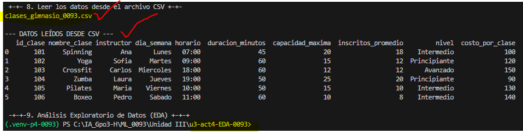
## 5.Análisis Exploratorio de Datos (EDA)
#### Primeros y ultimos registros
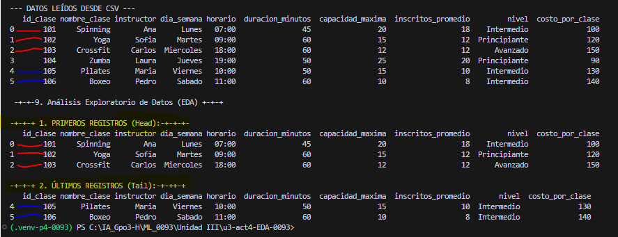
## 6.Dimensiones y estructura
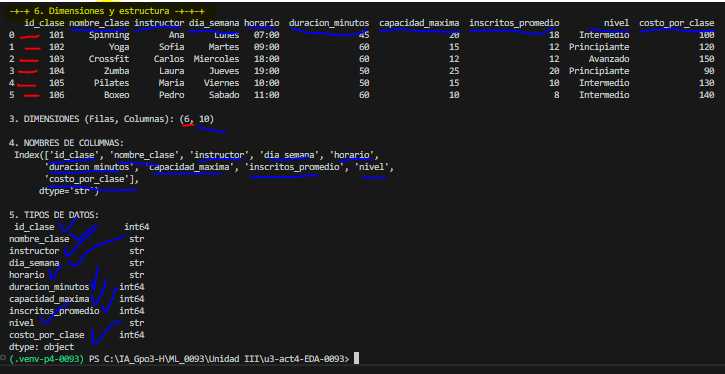
## 7.Estadistica y limpieza
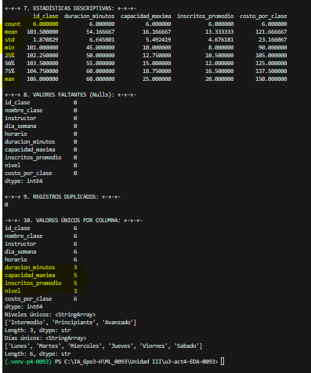
## 8 y 9. Ordenamiento, filtrado y agrupación
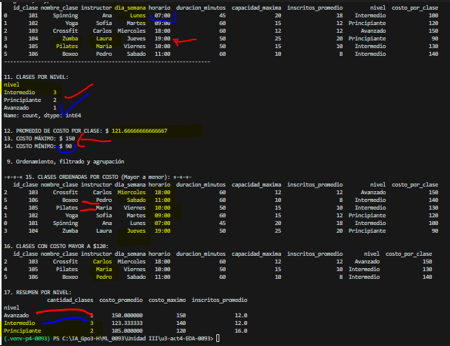
## 18.Gráfica de barras: Clases de Gimnasio
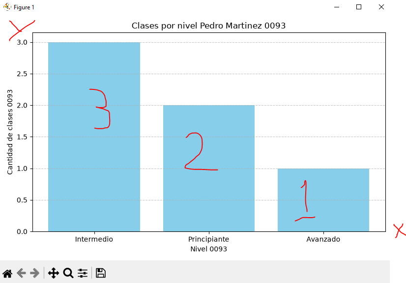
## 19.Grafica de barras:Costo de Clases
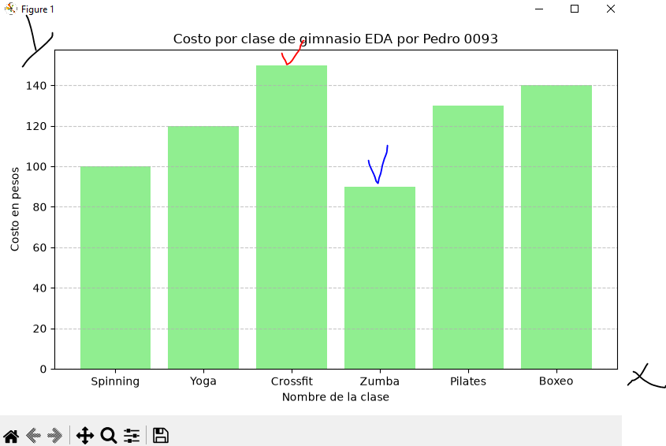
## 20.Histograma: Distribución de duración de clases
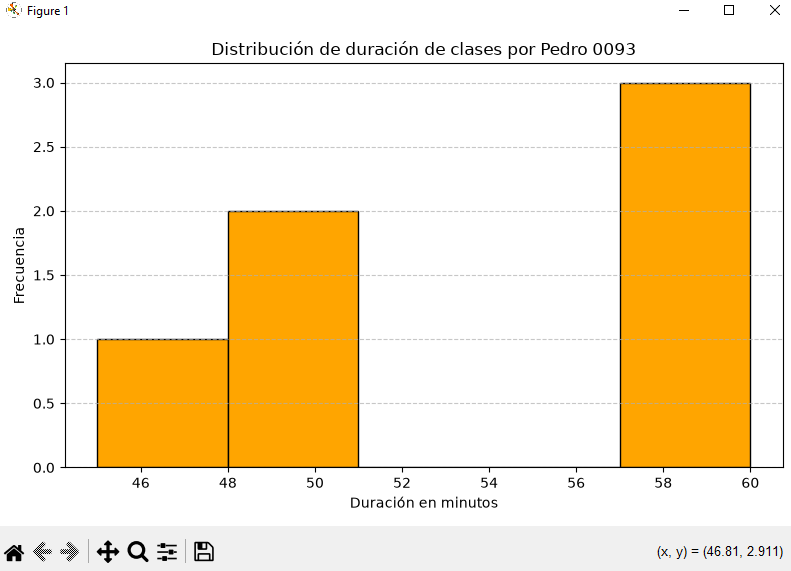
## 21. Gráfica de dispersión: Duración vs Costo
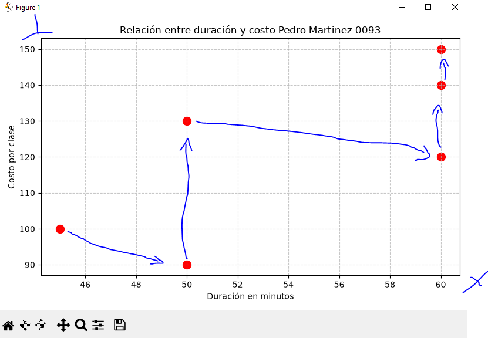
## 22. Diagrama de caja: Distribución de costos
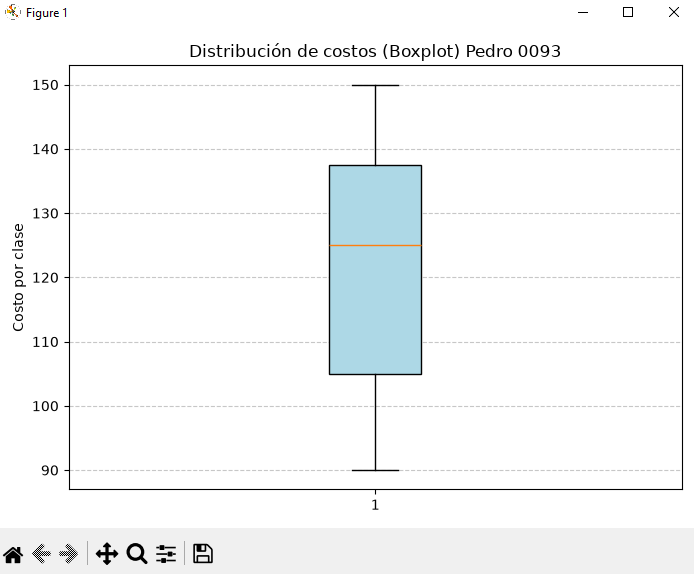
## 23. Matriz de correlación
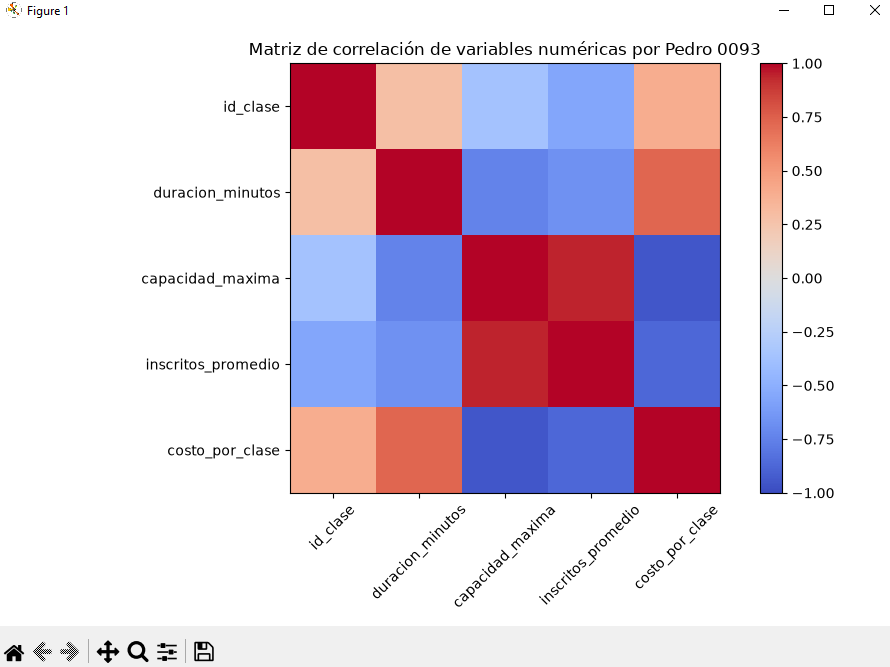